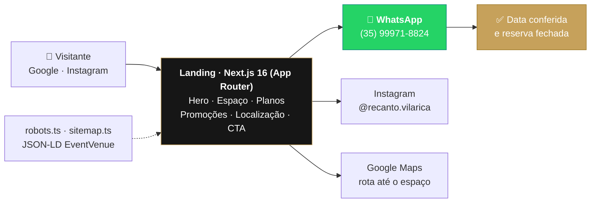

<div align="center">

<h1>✦ Recanto Vila Rica — Landing</h1>

<p><strong>A vitrine de um espaço de eventos em Lavras/MG: da busca no Google até a conversa no WhatsApp</strong></p>

<p>
  <a href="https://recanto-vila-rica-landing.vercel.app" target="_blank">
    
  </a>
</p>

<p>
  
  &nbsp;
  
  
  
  
  
  
</p>

</div>

---

## O que é

O **Recanto Vila Rica** é um espaço de eventos real, na Rua Bernardino Antônio Tomás, 21 — Jardim Vila Rica, Lavras/MG. Salão, área kids com monitor, espaço de decoração e piscina, alugados para aniversários, casamentos, formaturas e confraternizações. Quem procura "espaço para eventos em Lavras" quer saber três coisas antes de qualquer outra: **como é o lugar, quanto custa e a data está livre?**

Esta landing responde as duas primeiras e entrega a terceira para um humano. Ela mostra o espaço em foto, publica o preço aberto — sem "consulte-nos" — e joga o visitante no WhatsApp da equipe, que é onde a disponibilidade é checada e a reserva fecha. **Não há carrinho, checkout, login ou formulário**: o funil inteiro tem um passo, e o passo é uma conversa.

São **7 seções** em uma única rota (`/`), montadas por **10 componentes**, cobrindo 5 ambientes no carrossel, 3 planos e 3 promoções — tudo estático, sem backend, servido pela Vercel.



---

## ✨ Destaques de engenharia

**Zero formulário — e essa é a decisão.** Não existe um `<form>` ou um `<input>` no repositório inteiro. Houve uma seção de orçamento com formulário (branch `feat/budget-section`, "form integration placeholder") e ela não sobreviveu à migração para Next.js. Todo CTA — hero, cada card de plano, o botão flutuante, o rodapé — aponta para o mesmo `wa.me/5535999718824`. Sem formulário não há backend para manter, lead para armazenar, e-mail transacional para configurar nem dado pessoal parado num banco. **A landing não coleta: ela encaminha.**

**GSAP nunca entra no bundle inicial.** Toda animação importa a lib dentro do `useEffect` — `const { gsap } = await import('gsap')`, e o mesmo para `ScrollTrigger`. O import dinâmico mantém a biblioteca de animação fora do carregamento inicial e fora do servidor: ela só chega depois que o componente monta no cliente. Na mesma linha, `'use client'` só aparece em quem realmente anima ou escuta evento — `Footer` e `layout` continuam Server Components.

**Os elementos nascem invisíveis de propósito.** Cada alvo de animação já vem `opacity-0` no markup e é o GSAP que o revela. Isso mata o flash de conteúdo não animado que aparecia antes (`fix: elementos do hero iniciam invisíveis para animação GSAP funcionar`). O hook `useScrollAnimation` fecha o ciclo: `gsap.context()` com `revert()` no cleanup, `once: true` para o ScrollTrigger não re-disparar no scroll de volta, e `clearProps: 'all'` para devolver o controle dos estilos inline ao CSS assim que a animação termina.

**Fotos reais custam bytes reais.** As 5 fotos do espaço foram convertidas para WebP: **712 KB → 489 KB, ~31% a menos** no que o visitante baixa. Como a galeria é o coração da página, o `layout` faz `preload` da imagem do LCP (`/assets/salao.webp`) e da logo SVG antes do parser chegar nelas; `next/image` entra com `fill` + `sizes` para não servir foto de 1200px para thumbnail de 200px, e `priority` marca só o que aparece acima da dobra. O mapa do Google, que não é crítico, é `loading="lazy"`.

**SEO local tratado como feature, não como checklist.** A Metadata API do Next define `metadataBase`, canonical, Open Graph e Twitter card; `robots.ts` e `sitemap.ts` são rotas geradas, não arquivos estáticos que envelhecem. O diferencial é o JSON-LD de `EventVenue` no `layout`: endereço, coordenadas, telefone, horário de funcionamento e `priceRange` estruturados para o Google entender que isto é um local que aluga espaço em Lavras — e não um blog sobre festas. O arquivo de verificação do Search Console está versionado em `public/`.

**Scroll-jacking com freio.** A seção de promoções troca o card com a roda do mouse, mas só quando ela está de fato na viewport (checagem de `getBoundingClientRect`), com listener `passive: true` e throttle de 700 ms guardado em `useRef`. Um giro de scroll = uma promoção: sem isso, um único gesto de trackpad atravessaria as três de uma vez.

---

## 🎬 Seções

<table>
  <thead>
    <tr><th>Seção</th><th>O que faz</th></tr>
  </thead>
  <tbody>
    <tr><td><code>Navbar</code></td><td>Sticky com blur e estado de scroll (&gt; 60px), menu mobile, âncoras para as 4 seções</td></tr>
    <tr><td><code>HeroSection</code></td><td>Timeline GSAP encadeada (logo → marca → divisor → headline → CTA → prova social), nome da marca em gradiente dourado, CTA duplo: WhatsApp e <code>#espaco</code></td></tr>
    <tr><td><code>MarqueeBrand</code></td><td>Faixa dourada em loop infinito — itens duplicados e <code>x: -totalWidth</code> com <code>repeat: -1</code> para emenda invisível</td></tr>
    <tr><td><code>SpacesSection</code> <sub>#espaco</sub></td><td>Carrossel dos 5 ambientes (salão, espaço de festa, área kids, piscina, entrada) com crossfade GSAP, thumbnails e navegação circular</td></tr>
    <tr><td><code>PricingSection</code> <sub>#planos</sub></td><td>3 planos com preço aberto — Promocional (R$ 649,99, Seg–Qui, destacado), Essencial (R$ 849,99) e Completo (R$ 999,99, com piscina); cards entram com stagger no scroll</td></tr>
    <tr><td><code>PromotionsSection</code> <sub>#promocoes</sub></td><td>Indique e Ganhe, Sorteio VIP e Sempre Aqui — carrossel vertical dirigido pela roda do mouse, com throttle</td></tr>
    <tr><td><code>LocationSection</code> <sub>#localizacao</sub></td><td>Mapa embedado com lazy load, endereço completo com CEP e botão de rota no Google Maps</td></tr>
    <tr><td><code>CTASection</code></td><td>Fechamento em 3 cards: WhatsApp (principal), Instagram e retorno aos planos</td></tr>
    <tr><td><code>Footer</code></td><td>Contato (WhatsApp, <code>tel:</code>, Instagram), endereço e ano dinâmico</td></tr>
    <tr><td><code>WhatsAppFloat</code></td><td>Botão flutuante que só aparece depois de 300px de scroll — não compete com o CTA do hero</td></tr>
  </tbody>
</table>

O design é um sistema fechado: dourado `#C6A15B`, creme `#F8F4EE` e tinta `#161616`, declarados uma vez no `@theme` do Tailwind 4 e reusados em toda a página.

---

## 🛠️ Stack

<table>
  <tbody>
    <tr>
      <td><strong>Framework</strong></td>
      <td>   — App Router, <code>strict</code> ligado</td>
    </tr>
    <tr>
      <td><strong>Estilo</strong></td>
      <td> (CSS-first, <code>@theme</code> — sem arquivo de config) </td>
    </tr>
    <tr>
      <td><strong>Animação</strong></td>
      <td> + <code>ScrollTrigger</code> — carregados por import dinâmico</td>
    </tr>
    <tr>
      <td><strong>UI</strong></td>
      <td> — componentes próprios (<code>Badge</code>, <code>Button</code>)</td>
    </tr>
    <tr>
      <td><strong>Performance</strong></td>
      <td>  — preload do LCP, <code>sizes</code>, <code>priority</code></td>
    </tr>
    <tr>
      <td><strong>SEO</strong></td>
      <td>  — <code>robots.ts</code>, <code>sitemap.ts</code>, Open Graph, Search Console</td>
    </tr>
    <tr>
      <td><strong>Qualidade</strong></td>
      <td>  — build validado a cada push e PR em <code>main</code></td>
    </tr>
    <tr>
      <td><strong>Deploy</strong></td>
      <td> — <a href="https://recanto-vila-rica-landing.vercel.app">recanto-vila-rica-landing.vercel.app</a></td>
    </tr>
  </tbody>
</table>

---

## 🚀 Rodando localmente

### Pré-requisitos

| Requisito | Versão | Observação |
|---|---|---|
| **Node.js** | **20+** | É a versão que o CI usa (`actions/setup-node` com `node-version: 20`). O repo não tem `.nvmrc` nem `engines` |
| **npm** | acompanha o Node | O lockfile versionado é `package-lock.json` — use `npm`, não `pnpm`/`yarn` |

Não há banco de dados, container, serviço externo obrigatório nem conta em API para criar. **É uma página estática: clonar, instalar e rodar.**

### Passo a passo

```bash
# 1. clone o repositório
git clone https://github.com/mateus-vitor-ferreira-dev/recanto-vila-rica-landing-page.git
cd recanto-vila-rica-landing-page

# 2. instale as dependências (npm ci respeita o lockfile — é o que o CI roda)
npm ci

# 3. suba o servidor de desenvolvimento (Next 16 usa Turbopack por padrão)
npm run dev
```

Pronto: **http://localhost:3000**. Não há passo 4 — sem migration, sem seed, sem `.env` para preencher.

### Variáveis de ambiente

**Não existe nenhuma.** Isso não é um resumo: o código não lê uma única `process.env.*` ou `NEXT_PUBLIC_*`, não há `.env.example` nem qualquer arquivo `.env*` no repositório, e o `next.config.ts` está vazio. A landing não fala com nenhum serviço que precise de chave.

Os dados de negócio são conteúdo, não configuração — ficam versionados no componente que os exibe:

| O que | Onde muda |
|---|---|
| Telefone do WhatsApp (`wa.me/5535999718824`) | `Navbar`, `HeroSection`, `PricingSection`, `CTASection`, `Footer`, `WhatsAppFloat` |
| Planos e preços | array `plans` em `src/components/landing/PricingSection.tsx` |
| Promoções e validade | array `promotions` em `src/components/landing/PromotionsSection.tsx` |
| Ambientes e fotos | array `spaces` em `src/components/landing/SpacesSection.tsx` |
| Endereço e mapa | `src/components/landing/LocationSection.tsx` |
| URL canônica do site | `siteUrl` em `src/app/layout.tsx` (espelhada em `robots.ts` e `sitemap.ts`) |

> Se um dia entrar uma chave (analytics, formulário, CRM), ela vem via `.env.local` — que **nunca** deve ser commitado.

### Onde a aplicação responde

| Recurso | URL local |
|---|---|
| Landing | `http://localhost:3000` |
| Sitemap gerado | `http://localhost:3000/sitemap.xml` |
| Robots gerado | `http://localhost:3000/robots.txt` |
| Imagem do OG | `http://localhost:3000/assets/salao.webp` |

### Como verificar que subiu

```bash
# deve responder 200
curl -s -o /dev/null -w "%{http_code}\n" http://localhost:3000

# deve imprimir o título com o SEO já aplicado
curl -s http://localhost:3000 | grep -o "<title>[^<]*</title>"
# <title>Recanto Vila Rica — Espaço para Eventos em Lavras, MG</title>
```

No navegador, o sinal de que está tudo certo é a **logo aparecer com animação de entrada** e o nome "Recanto Vila Rica" surgir em dourado — se o GSAP não rodou, você vê o hero vazio (veja abaixo).

### Testando o build de produção

```bash
npm run build    # é exatamente o que o CI valida
npm start        # serve o build otimizado em http://localhost:3000
```

### Problemas comuns

| Sintoma | Causa e solução |
|---|---|
| **Página em branco / hero vazio** | Não é bug de carregamento: os elementos nascem `opacity-0` e é o GSAP que os revela. Sem JavaScript no cliente (extensão bloqueando, erro no console), o conteúdo existe no HTML mas fica invisível. Abra o console antes de investigar qualquer outra coisa |
| **Porta 3000 ocupada** | `npm run dev -- -p 3001`. Lembre que o `npm start` também usa a 3000 |
| **Mapa da seção Localização não carrega** | O iframe aponta para o Google Maps: precisa de internet. Offline, o resto da página funciona normalmente |
| **Animações "pulando" no scroll** | Os `ScrollTrigger` usam `once: true` — cada seção anima uma vez só, por design. Recarregue a página para vê-las de novo |
| **Erro de build por versão de Node** | Next 16 não roda em Node antigo. Confira com `node -v` e alinhe com o Node 20 do CI |

---

## 🧭 CI

```yaml
# .github/workflows/ci.yml — a cada push e PR em main
npm ci
npm run build
```

Não há suíte de testes neste repositório: o portão é o build. Se um componente quebra a tipagem ou uma importação some, o `next build` reprova o PR antes do merge.

---

## 📜 Scripts

| Script | O que faz |
|---|---|
| `npm run dev` | Servidor de desenvolvimento com HMR em `http://localhost:3000` |
| `npm run build` | Build de produção — o mesmo comando que o CI roda |
| `npm start` | Serve o build de produção (requer `build` antes) |
| `npm run lint` | ESLint 9 com `eslint-config-next` |

---

<div align="center">
  <sub>
    <a href="https://recanto-vila-rica-landing.vercel.app"><strong>Site no ar</strong></a> ·
    <a href="https://github.com/mateus-vitor-ferreira-dev/recanto-vila-rica-web">Web app</a>
  </sub>
</div>
